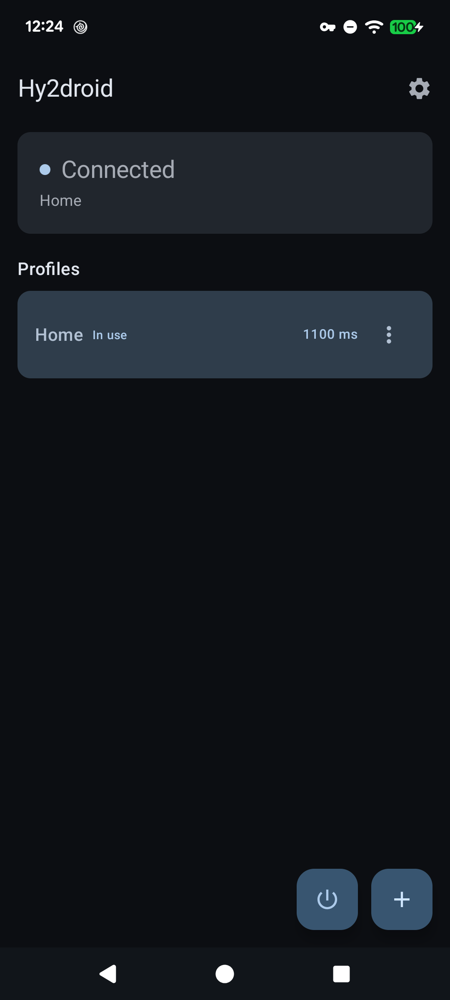
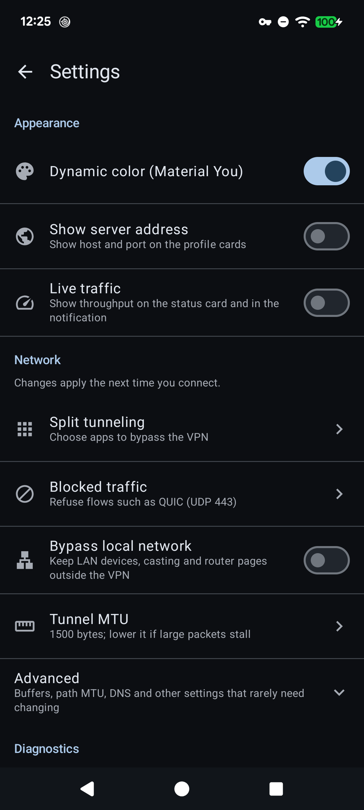

# Hy2droid — a native Hysteria 2 client for Android

> Applies to release `v0.9.0`. Older versions keep their documentation on the project site
> under `versions/<tag>/`, for example
> [`versions/v0.9.0/settings.md`](https://noelbennettz.github.io/Hy2droid/versions/v0.9.0/settings.md).

[](https://github.com/noelbennettz/Hy2droid/releases)
[](https://noelbennettz.github.io/Hy2droid/)
[](#requirements)
[](core/core.properties)
[](LICENSE)

Hy2droid is a native Android client for the [Hysteria 2](https://v2.hysteria.network/)
proxy protocol. The interface is built with Kotlin and Jetpack Compose (Material 3)
on top of Android's `VpnService`. The official Go core runs as a child process, and
`libtun2socks.so` moves traffic between the TUN device and that process.

A profile needs only the six values already carried by a `hysteria2://` share
link: server, port, password, SNI, obfuscation password and certificate policy.
To connect, paste a link, scan a QR code, or tap a link in a browser. There is no
YAML or config file to edit. The app needs no root, no Google Play Services and no
account, and it contains no analytics, crash reporting or ads. It is free software
under AGPL-3.0. You need an Android 11+ device and a Hysteria 2 server that you
supply yourself.

<p>
  
  
</p>

## Requirements

- Android 11 (API 30) or newer, on `arm64-v8a`, `armeabi-v7a`, `x86` or `x86_64`.
- JDK 17 to build the app.
- Android SDK platform 37 — `compileSdk 37`, `targetSdk 37` in `app/build.gradle`.
- No NDK: `libtun2socks.so` is a committed prebuilt pinned by
  `native/tun2socks/SHA256SUMS`, and the Hysteria core is a downloaded binary.
- Internet access on the build machine: the core is fetched from the upstream
  release and checksum-verified during the build. It is pinned to
  `core/core.properties`; an offline build reuses `libhysteria.so` files that match
  those hashes (see
  [Building offline, or through a mirror](DOCS.md#building-offline-or-through-a-mirror)).
- A Hysteria 2 server URI (`hysteria2://…`), or its QR code, to connect to.

## Install

When a release is published, take an APK from its
[Releases](https://github.com/noelbennettz/Hy2droid/releases) page. Until then,
build from source (see below). A release provides these files:
`app-arm64-v8a-release.apk` fits nearly every phone, and
`app-universal-release.apk` runs on any ABI; `app-armeabi-v7a-release.apk`,
`app-x86-release.apk` and `app-x86_64-release.apk` are the remaining splits. If
you are not sure which ABI your device uses, `adb shell getprop ro.product.cpu.abi`
prints it.

Open the APK and allow the browser or file manager to install unknown apps when
Android asks; that permission is per app and can be revoked afterwards. Add a
server with the `+` button: *Import from link* reads a `hysteria2://` link from
the clipboard, *Scan QR code* opens the camera, and *Enter manually* opens the
editor. Opening the link on the device also works: the browser hands it to the
app, which imports it without a form. Then press the power button and accept the
VPN consent dialog, which appears once per app. The query parameters of a share
link (`sni`, `obfs`, …) are optional; the server and password are not:

```
hysteria2://password@server.example.com:443/?sni=server.example.com&obfs=salamander&obfs-password=secret&insecure=1#My%20node
```

Installing a newer APK over the installed one keeps profiles and settings, because
every release is signed with the same key.

## Verify your download

Every release includes `SHA256SUMS.txt` next to the APKs, and its release notes
end with the SHA-256 fingerprint of the signing certificate. You can check both on
the machine that holds the download:

```bash
sha256sum -c SHA256SUMS.txt --ignore-missing    # only the APKs you downloaded
apksigner verify --print-certs app-arm64-v8a-release.apk
```

`--ignore-missing` is what makes the first command work after a partial download.
The file lists every APK in the release; the ones you did not download are
skipped instead of reported as missing. `apksigner` comes with the Android SDK
build-tools (`$ANDROID_HOME/build-tools/*/apksigner` and needs a JDK), and the
`Signer #1 certificate SHA-256 digest` line it prints must match:

```
af9c2fa9acffcd5af4d0a2d7924ec45185118adf37eeeba38e4dda547dd4bf9b
```

This is the release key used for every APK on the Releases page (`af:9c:2f:…`
with the usual colons). On the phone, an app such as AppVerifier shows the same
digest for an installed APK, which helps when the APK came from somewhere other
than Releases.

Every release is also attested by the workflow that built it, so the file can be
tied to a commit without trusting the release page:

```bash
gh attestation verify app-arm64-v8a-release.apk --repo noelbennettz/Hy2droid
```

`BUILD-INFO.txt` in the same release records the commit, the version and
versionCode, the bundled core version, the SHA-256 of each `libtun2socks.so`, and
the signing certificate. See
[DOCS > Reproducibility and provenance](DOCS.md#reproducibility-and-provenance)
for what is deterministic and what cannot be.

## Build from source

On a fresh clone, set up both prerequisites first: Gradle needs JDK 17, and it
finds the SDK through `local.properties`. Then run:

```bash
export JAVA_HOME=/path/to/jdk17                  # Gradle needs JDK 17
echo "sdk.dir=$ANDROID_HOME" > local.properties  # gitignored; points at the SDK
./gradlew assembleDebug                          # app/build/outputs/apk/debug/
```

Other useful commands are `./gradlew testDebugUnitTest`, `./gradlew lintDebug`
(errors fail the build), `./gradlew connectedDebugAndroidTest` (instrumentation
tests; needs a device or emulator on API 30+), `./gradlew assembleRelease` (signed
when a keystore is present), and `scripts/check-style.sh` (`--fix` rewrites the
mechanical violations). The first build downloads the pinned core into
`app/src/main/jniLibs/<abi>/libhysteria.so`; see [DOCS.md](DOCS.md) for the core
tooling, instrumentation tests, signing secrets and CI jobs.

A local build takes its version from git: `0.9.0-dev.11+g1f5e2fa` on an untagged
commit, or the tag itself on a tagged one. `versionName` and `versionCode`
therefore match what a release from that commit would use.

## Documentation

| Document | Covers |
| --- | --- |
| [DOCS.md](DOCS.md) | Features in detail, every setting and profile field, blocked-port rules, split tunnelling, internals, repository layout, build and core scripts, CI and signing, security notes, troubleshooting, FAQ |
| [CONTRIBUTING.md](CONTRIBUTING.md) | Development setup, the checks to run before opening a pull request, the DCO sign-off every commit needs, and what the project will not accept |
| [PLAY_RELEASE.md](PLAY_RELEASE.md) | The Google Play checklist: artefacts, data safety, privacy policy, `specialUse` foreground service, internal track — all manual, no Play API |
| [native/tun2socks/README.md](native/tun2socks/README.md) | The patches applied to hev-socks5-tunnel, the SHA-256 manifest, and how to rebuild `libtun2socks.so` reproducibly |
| [Project site](https://noelbennettz.github.io/Hy2droid/) | English and Traditional Chinese pages, hosted in the [`noelbennettz.github.io`](https://github.com/noelbennettz/noelbennettz.github.io) repository under `docs/Hy2droid/` |

## Security

Report a vulnerability through GitHub's **Security → Report a vulnerability** form
on this repository, never in a public issue. If that form is unavailable, open an
issue titled `Security contact request` with no technical detail. There is no
security email address and no promised response time.

[SECURITY.md](SECURITY.md) lists what is in scope: the app, the `VpnService` and
TUN handling, share-link parsing, the certificate policy behind `insecure=1`, and
the signing and release chain. It also lists what is out of scope: upstream
Hysteria core bugs, settings you chose on purpose, and the server side.
[DOCS.md](DOCS.md#security-notes) explains where the secrets live and which
threats the app does not defend against.

## Licence

Hy2droid is released under the **GNU Affero General Public License v3.0**
(AGPL-3.0); the full text is in [LICENSE](LICENSE). The project notice and the
third-party MIT notice are in [NOTICE](NOTICE). The in-app screen under *Settings
→ About → Open source licenses* lists every Maven dependency and both native
components, with versions, licences and the full native licence texts. That list
is generated at build time instead of fetched, so it works offline.

AGPL section 13 (network use) does not apply here: Hy2droid runs on the device.
The distribution side does apply. Every APK is published together with this source
tree, and if you modify the app and distribute the result, you must offer the
source of your version too.

Each release also carries an SPDX 2.3 SBOM (`hy2droid-<version>.spdx.json`) that
lists the Maven artefacts and native components with their versions and licences.
CI verifies every component's licence text against `native/LICENSES.tsv`, `NOTICE`
and the assets the app shows. See
[DOCS > Licences and the SBOM](DOCS.md#licences-and-the-sbom).
